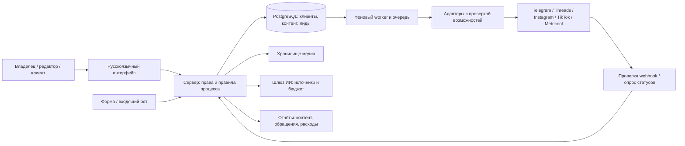

# Архитектура v1.0

## Подход

Проектное решение: модульное серверное приложение с отдельным фоновым процессом. Одна база PostgreSQL, объектное хранилище медиа и резервные копии. Не начинать с микросервисов, множества автономных агентов или зависимого от конкретного чата сценария. Реализация должна работать без открытого окна Codex.

Предлагаемый стек: TypeScript для интерфейса/сервера/worker, PostgreSQL для данных и очереди, S3-совместимое хранилище, Docker Compose для локального запуска. Конкретные библиотеки и поддерживаемые версии выбрать в CF-001 по актуальной документации и зафиксировать lockfile. Это рекомендация, а не уже установленный стек.

## Модули и границы

1. **Клиенты и доступ:** workspace, membership, brand, роли. Клиентский контекст устанавливает сервер по сессии и членству.
2. **Знания:** версии брифа, факт/источник, разрешение на медиа, срок актуальности. В MVP полнотекстовый поиск и выбор источников достаточны; векторный поиск добавлять при измеренной необходимости.
3. **Производство:** бриф → план → материал → версии вариантов по платформам → источники утверждений → согласование.
4. **Доставка:** валидация, календарь, очередь, адаптеры, подтверждение публикации, ручной маршрут.
5. **Измерение:** исходные ответы провайдера с ограниченным сроком хранения, нормализованные показатели и история определений.
6. **Возможности и продажи:** публичные ссылки/поисковые результаты → отбор человеком; отдельно входящие обращения → квалификация → исход сделки.
7. **Эксплуатация:** расходы, лимиты, секреты, аудит, резервные копии, уведомления об ошибках.

Ни модель ИИ, ни текст внешнего поста не получают прямого права вызвать publish. Модель возвращает структурированный черновик; сервер проверяет поля, права, бюджет и одобрение.

## Данные

| Сущности | Ключевые поля / инвариант |
|---|---|
| Workspace, Membership, Brand | Каждый бренд принадлежит одному workspace; пользователь видит только разрешённые бренды |
| Offer, BrandBriefVersion | Версия оффера, аудитория, регион, CTA, проверенные факты; без подтверждённого оффера коммерческий текст не одобряется |
| Source, Fact, Asset | workspace_id, brand_id, provenance, дата проверки, права использования; ключи объектов изолированы по клиенту |
| ContentItem, ContentVersion, Variant | Исходный сюжет и неизменяемые версии текста/медиа для площадки |
| Approval | variant_version_id, approver, account_id, schedule, settings_hash, timestamp |
| AccountConnection, CapabilityEvidence | Провайдер, внешний ID, ссылка на секрет, scopes, expiry, формат, состояние доступа, дата и доказательство теста |
| Publication, PublishAttempt | Уникальный ключ задания, snapshot, provider/container/post IDs, статус, error_class, request_id |
| MetricSnapshot | publication_id, provider_metric, value nullable, unit, period, observed_at, availability, definition_version |
| Opportunity | URL, контекст, источник, релевантность, решение человека; это не Lead |
| Lead, LeadEvent, Deal | Контакт минимального объёма, основание обработки, campaign_id, история статусов; оплата отдельно от суммы предложения |
| Campaign, AttributionEvent | Непрозрачные коды, каналы, правило атрибуции и уровень уверенности |
| UsageEvent, CostEntry, AuditEvent | Фактический/оценочный расход, валюта, источник ставки; действие пользователя без секретов |

В каждой бизнес-таблице workspace_id обязателен. brand_id обязателен там, где объект относится к бренду. Составные внешние ключи предотвращают связь версии клиента A с аккаунтом B. Уникальность внешних ID задаётся с учётом провайдера и аккаунта. RLS в базе плюс проверка членства на сервере; фоновые задачи получают явный workspace_id. Пользовательский workspace_id из запроса не является доказательством права.

## Состояния и согласование

Контент: draft → in_review → approved; отклонение → draft. Изменение текста, медиа, аккаунта, времени или платформенных настроек создаёт новую версию и снимает старое разрешение на доставку. Перед отправкой worker повторно проверяет approval hash, capability и паузу бренда.

Публикация: ready → scheduled → dispatching → provider_accepted → published. Дополнительные состояния: manual_required, retry_wait, unknown, failed, cancelled. provider_accepted означает только приём провайдером. published требует внешнего подтверждения финального результата; для ручного пути показывается «подтверждено оператором», отдельно от API-подтверждения.

Согласование в нашей системе и Metricool review — разные состояния. Нельзя считать создание «для проверки» внешним одобрением. Для одного задания выбирается ровно один путь доставки: прямой API, Metricool либо ручной; переключение при неизвестном исходе запрещено до сверки.

## Очередь и обработка ошибок

Транзакция сохраняет согласованное задание и outbox. Worker забирает due-запись с блокировкой и lease. Уникальный ключ: workspace + account + variant_version + согласованная ревизия расписания. Перед повтором проверяется история и известный внешний ID.

- 401/403: приостановить соединение, указать необходимость переподключения/прав; не повторять бесконечно.
- 429: учитывать Retry-After и бюджет запросов аккаунта, экспоненциальная задержка с jitter.
- 5xx: ограниченный повтор, только когда он не создаст повторную запись; лимит попыток и возраста задания в настройках.
- Таймаут после отправки: unknown → запрос статуса/сверка по известному ID → ручное разрешение, если провайдер не позволяет выяснить результат. Слепая повторная отправка запрещена.
- Ошибка формата: failed с понятной причиной, правка через новую версию.
- Отмена: локальную очередь можно остановить до отправки. После принятия провайдером отмена требует отдельного подтверждённого действия; удаление внешнего поста не предполагается автоматически.

Обещать exactly-once нельзя: без идемпотентности провайдера остаётся неопределённость. Цель системы — предотвращать известные дубли и явно разбирать неизвестный исход.

## Контракт адаптера

Операции: identify, validateDraft, submit, getStatus, fetchMetrics; cancel и search только как optional capabilities. Ответ submit содержит внешний ID, тип подтверждения и sanitized evidence. Нет getStatus — нельзя синтезировать успех по таймеру. Нет API метрики — возвращается unsupported, не 0.

Реестр возможностей имеет состояния documented, awaiting_access, verified, blocked, expired. verified относится к конкретному аккаунту, формату, версии API и дате проверки. Тесты mock не повышают его до verified. Отключение токена немедленно запрещает новые задания.

Для Metricool отдельно хранятся ID записи планировщика и конечного поста. Для Instagram/Threads — container ID и post ID. Для TikTok — publish_id и подтверждение результата. В аналитике не заменять один ID другим по совпадению названия.

## Безопасность и персональные данные

OAuth штатного провайдера, одноразовый state, минимальные scopes; проверять актуальные требования выбранной платформы. Токены зашифрованы, ключ хранится отдельно от базы и бэкапа. Не помещать секреты в браузер, URL отчётов, логи или промпты. Загрузка медиа проверяет тип, размер, содержимое и доступ клиента; получение по URL защищено от запросов к внутренним адресам. Экспорт CSV защищается от формул.

Webhook проверяет подпись/секрет по документации адаптера, связывается с аккаунтом на сервере, дедуплицируется по event ID и безопасно обрабатывает повтор/нарушенный порядок. Для Telegram — secret_token и уникальность update_id.

Предлагаемая политика пилота: контакты неактивных лидов — 90 дней с проверкой основания дальнейшего хранения; технические журналы — 30 дней; агрегаты и финансовые данные услуги — отдельная утверждённая политика. Это настройки проекта, не юридические сроки. Применимые правила, регион хранения и текст формы определяются до приёма реальных заявок. При удалении клиента учитываются медиа, внешние провайдеры и срок истечения резервных копий.

## Эксплуатация

Постоянно работающий worker, TLS, health checks, ежедневный зашифрованный бэкап с пробным восстановлением. Раздельные тестовые и рабочие аккаунты/секреты. Журналировать корреляционный ID, бренд, тип действия, статус и длительность без текста личных сообщений и контактов по умолчанию.

Сигналы оператору: токен истёк; очередь просрочена; неизвестный исход; лимит расходов; webhook не проходит; метрики устарели. Отчёт об ошибке содержит ответственного и ручной путь. Лимиты ИИ на запрос, день и бренд, резервирование бюджета до вызова и учёт факта после него; при превышении — пауза новых генераций без удаления готового контента.

Переезд: миграции схемы, выгрузка данных и объектов, секреты переподключаются штатно, очередь восстанавливается с сохранением внешних ID. Не переносить активные задания в новый планировщик без сверки старых, иначе возникнут дубли.
